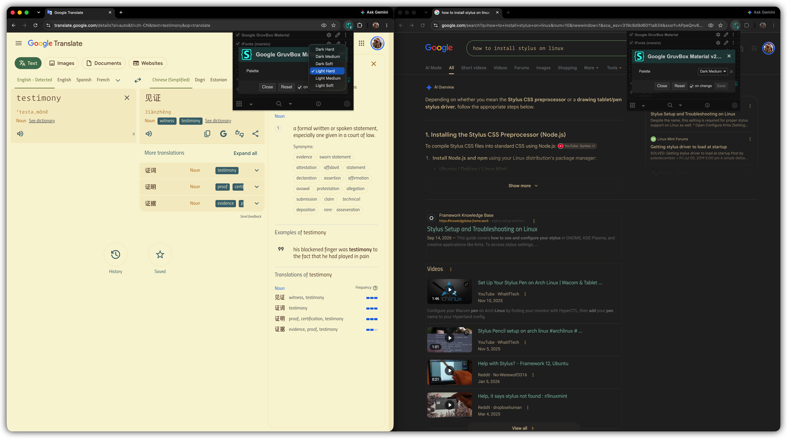
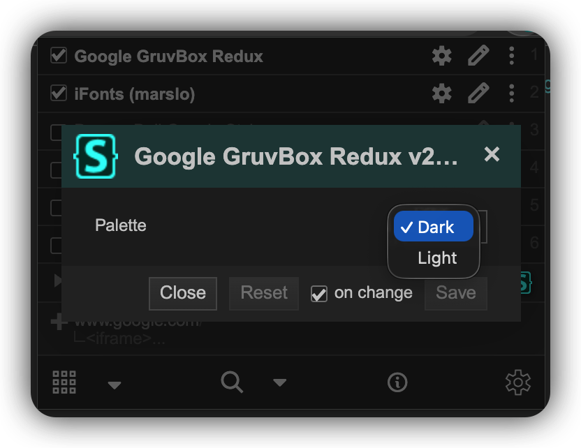
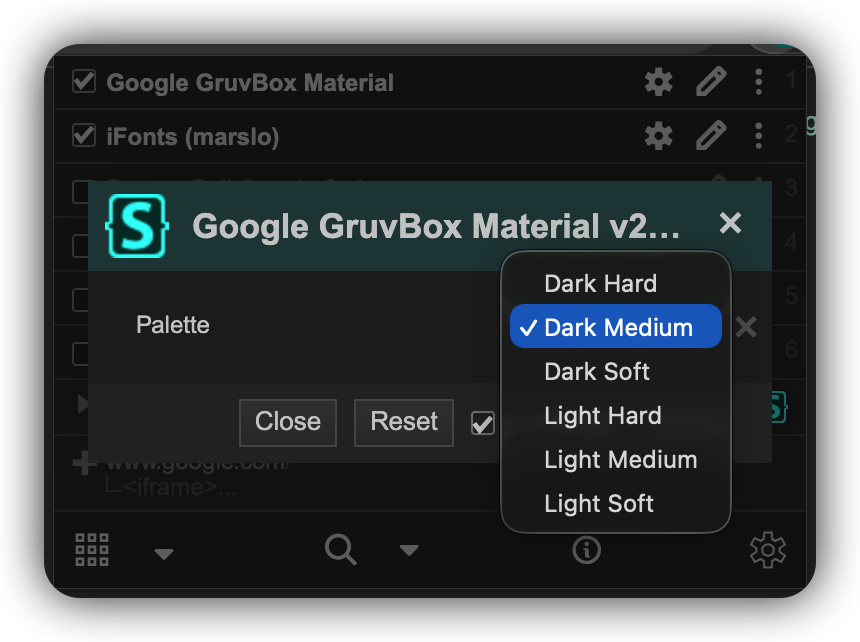

# Google GruvBox

[gruvbox](https://github.com/morhetz/gruvbox) and [gruvbox-material](https://github.com/sainnhe/gruvbox-material) themes for Google Search ( including AI Mode ) and Google Translate.

|               Google GruvBox Redux Translate (light) · Search (dark)               |           Google GruvBox Material Translate (light hard) · Search (dark medium)          |
| :-----------------------------------------------------------------------------------: | :-----------------------------------------------------------------------------------------: |
|  |  |

## Installation

1. install [Stylus](https://github.com/openstyles/stylus): [Chrome](https://chromewebstore.google.com/detail/stylus/clngdbkpkpeebahjckkjfobafhncgmne) | [Firefox](https://addons.mozilla.org/firefox/addon/styl-us/) | [Edge](https://microsoftedge.microsoft.com/addons/detail/stylus/dmcfbglnmkadeibaoelljihicilhlnjd)
2. click to install one of the styles:

| STYLE                                    | PALETTE                                                                     | GITHUB                                                                                                                    | USERSTYLES.WORLD                                                                                                                                              |
| ---------------------------------------- | --------------------------------------------------------------------------- | ------------------------------------------------------------------------------------------------------------------------- | ------------------------------------------------------------------------------------------------------------------------------------------------------------- |
| Google GruvBox Material                  | [gruvbox-material](https://github.com/sainnhe/gruvbox-material), 6 palettes | 📦 [google-gruvbox-material.user.css](https://github.com/marslo/google-gruvbox/raw/main/google-gruvbox-material.user.css) | 📦 [install](https://userstyles.world/api/style/30994.user.css) \| [userstyles.world](https://userstyles.world/style/30994/google-gruvbox-material)           |
| Google GruvBox Redux                     | [gruvbox](https://github.com/morhetz/gruvbox), dark / light                 | 📦 [google-gruvbox.user.css](https://github.com/marslo/google-gruvbox/raw/main/google-gruvbox.user.css)                   | 📦 [install](https://userstyles.world/api/style/12346.user.css) \| [userstyles.world](https://userstyles.world/style/12346/google-gruvbox-redux)              |
| Gruvbox Google ( upstream, search only ) | [gruvbox](https://github.com/morhetz/gruvbox) dark                          | —                                                                                                                         | 📦 [install](https://userstyles.world/api/style/7350.user.css) \| [userstyles.world](https://userstyles.world/style/7350/gruvbox-google) — by Touhidul Shawan |

> [!NOTE]
> Enable only one of them at a time — they style the same elements.

> [!TIP]
> Match Google's own appearance setting to the palette ( dark palette → Google dark mode, light palette → Google light mode ) — elements not covered by the style keep Google's colors.

## Palettes

|                 Google GruvBox Redux                |                 Google GruvBox Material                |
| :-------------------------------------------------: | :----------------------------------------------------: |
|  |  |

Switch in Stylus: style ⚙ **Configure** → `Palette`.

`google-gruvbox.user.css` ( Redux ):

| `Palette`          | BACKGROUND | FOREGROUND |
| ------------------ | ---------- | ---------- |
| `Dark` ( default ) | `#282828`  | `#d5c4a1`  |
| `Light`            | `#fbf1c7`  | `#3c3836`  |

`google-gruvbox-material.user.css` ( Material ):

| `Palette`               | BACKGROUND | FOREGROUND |
| ----------------------- | ---------- | ---------- |
| `Dark Hard` ( default ) | `#1d2021`  | `#d4be98`  |
| `Dark Medium`           | `#282828`  | `#d4be98`  |
| `Dark Soft`             | `#32302f`  | `#d4be98`  |
| `Light Hard`            | `#f9f5d7`  | `#654735`  |
| `Light Medium`          | `#fbf1c7`  | `#654735`  |
| `Light Soft`            | `#f2e5bc`  | `#654735`  |

## Scope

| SECTION                                      | MATCH                                                                                              |
| -------------------------------------------- | -------------------------------------------------------------------------------------------------- |
| Google Search                                | `domain("www.google.com")`                                                                         |
| Google bar popups ( app launcher / account ) | `url-prefix("https://ogs.google.com/")`, scoped to `html[stylus-iframe^="https://www.google.com"]` |
| Google Translate                             | `url-prefix("https://translate.google.")`                                                          |

### AI Mode

Styled within the Google Search section ( `domain("www.google.com")` ).

| AREA    | CHANGE                                                                                   |
| ------- | ---------------------------------------------------------------------------------------- |
| colors  | Google color tokens ( `--bbQxAb`, `--IXoxUe`, … ) remapped to the palette vars           |
| layout  | top nav, response column and input box widened to `85vw`, centered                       |
| sidebar | panel, current / hovered thread and the thread `...` menu use the palette                |
| input   | prompt textarea uses `--font-family-mono`                                                |

> [!WARNING]
> AI Mode class names and color tokens are obfuscated by Google and may change without notice.

## Development

- both styles are plain css ( `{}` syntax )

| FILE                               | `@name`                 | `@author`                                                                      |
| ---------------------------------- | ----------------------- | ------------------------------------------------------------------------------ |
| `google-gruvbox.user.css`          | Google GruvBox Redux    | Touhidul Shawan ( Google Search ) · Marslo Jiao ( Google Translate · AI Mode ) |
| `google-gruvbox-material.user.css` | Google GruvBox Material | Marslo Jiao                                                                    |

- both share `@namespace github.com/marslo`; `@updateURL` points to the raw file on `main`
- the `ai mode: …` blocks in the Google Search section are identical in both files — edit them together
- `google-gruvbox-material.user.css` keeps the same rules as `google-gruvbox.user.css`; only the palette differs:
  - the default palette ( Redux `Dark`, Material `Dark Hard` ) is defined in each section's `html { … }` block ( `--bg-primary`, `--fg-primary`, `--blue`, … )
  - other palettes are `@var select palette` options, expanded by the Stylus `uso` preprocessor into an `html:root { … }` override at `/*[[palette]]*/`

> [!IMPORTANT]
> Option values must not contain `*/` — it closes the `==UserStyle==` metadata comment early.

## Credits

- `google-gruvbox.user.css` ( Redux ): Google Search based on the original [Gruvbox Google](https://userstyles.world/style/7350/gruvbox-google) by [Touhidul Shawan](mailto:touhidulshawan@gmail.com) — [touhidulshawan/gruvbox-google](https://github.com/touhidulshawan/gruvbox-google); Google Translate and Google AI Mode by [Marslo Jiao](mailto:marslo.jiao@gmail.com)
- `google-gruvbox-material.user.css`: gruvbox-material palettes by [Marslo Jiao](mailto:marslo.jiao@gmail.com), built on the Redux rules
- palettes: [morhetz/gruvbox](https://github.com/morhetz/gruvbox), [sainnhe/gruvbox-material](https://github.com/sainnhe/gruvbox-material)
- [MIT License](./LICENSE)
