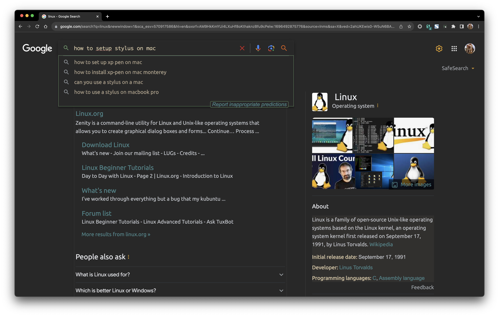
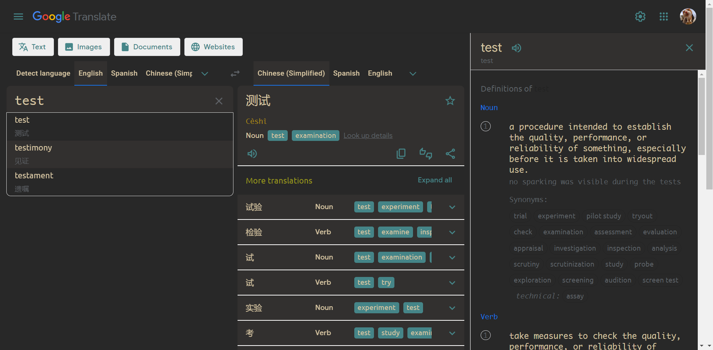

# Google GruvBox

[gruvbox](https://github.com/morhetz/gruvbox) and [gruvbox-material](https://github.com/sainnhe/gruvbox-material) themes for Google Search and Google Translate.

|                                         SEARCH                                         |                                         TRANSLATE                                         |
| :------------------------------------------------------------------------------------: | :---------------------------------------------------------------------------------------: |
|  |  |

## Installation

1. install [Stylus](https://github.com/openstyles/stylus): [Chrome](https://chromewebstore.google.com/detail/stylus/clngdbkpkpeebahjckkjfobafhncgmne) | [Firefox](https://addons.mozilla.org/firefox/addon/styl-us/) | [Edge](https://microsoftedge.microsoft.com/addons/detail/stylus/dmcfbglnmkadeibaoelljihicilhlnjd)
2. click to install one of the styles:

| style | palette | install |
|---|---|---|
| Google GruvBox Material (marslo) | [gruvbox-material](https://github.com/sainnhe/gruvbox-material), 6 palettes | 📦 [google-gruvbox-material.user.css](https://github.com/marslo/google-gruvbox/raw/main/google-gruvbox-material.user.css) |
| Google GruvBox (marslo) | [gruvbox](https://github.com/morhetz/gruvbox) dark | 📦 [google-gruvbox.user.css](https://github.com/marslo/google-gruvbox/raw/main/google-gruvbox.user.css) \| [userstyles.world](https://userstyles.world/api/style/12346.user.css) |
| Gruvbox Google ( upstream, search only ) | [gruvbox](https://github.com/morhetz/gruvbox) dark | 📦 [userstyles.world](https://userstyles.world/api/style/7350.user.css) — by [Touhidul Shawan](https://userstyles.world/style/7350/gruvbox-google) |

> [!NOTE]
> Enable only one of them at a time — they style the same elements.

> [!TIP]
> Match Google's own appearance setting to the palette ( dark palette → Google dark mode, light palette → Google light mode ) — elements not covered by the style keep Google's colors.

## Palettes

`google-gruvbox-material.user.css` — switch in Stylus: style ⚙ **Configure** → `Palette`.

| `Palette` | background | foreground |
|---|---|---|
| `Dark Hard` ( default ) | `#1d2021` | `#d4be98` |
| `Dark Medium` | `#282828` | `#d4be98` |
| `Dark Soft` | `#32302f` | `#d4be98` |
| `Light Hard` | `#f9f5d7` | `#654735` |
| `Light Medium` | `#fbf1c7` | `#654735` |
| `Light Soft` | `#f2e5bc` | `#654735` |

## Scope

| section | match |
|---|---|
| Google Search | `domain("www.google.com")` |
| Google Translate | `url-prefix("https://translate.google.")` |

## Development

- both styles use the Stylus `stylus` preprocessor ( indent syntax )
- `google-gruvbox-material.user.css` keeps the same rules as `google-gruvbox.user.css`; only the palette differs:
  - six palettes live in the `palettes` hash, `gruv-palette()` maps the selected one onto `--bg-primary`, `--fg-primary`, `--blue`, …
  - the `@var select palette` value is injected as `palette='…';` before compiling

> [!IMPORTANT]
> Indentation is significant: a rule indented less than its `@-moz-document` block falls out of it and applies to **every** site.

## Credits

- original [Gruvbox Google](https://userstyles.world/style/7350/gruvbox-google) ( Google Search ) by [Touhidul Shawan](mailto:touhidulshawan@gmail.com) — [touhidulshawan/gruvbox-google](https://github.com/touhidulshawan/gruvbox-google)
- Google Translate and gruvbox-material palettes by [Marslo Jiao](mailto:marslo.jiao@gmail.com)
- palettes: [morhetz/gruvbox](https://github.com/morhetz/gruvbox), [sainnhe/gruvbox-material](https://github.com/sainnhe/gruvbox-material)
- [MIT License](./LICENSE)
